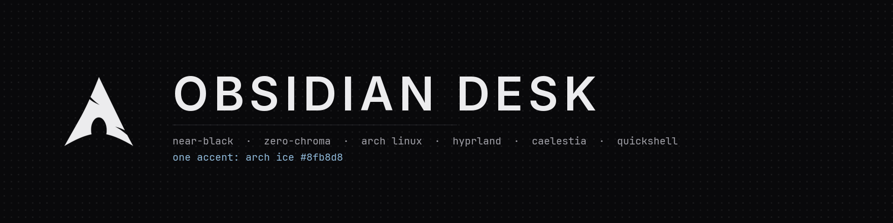
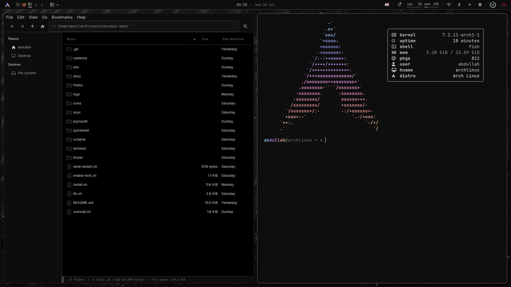
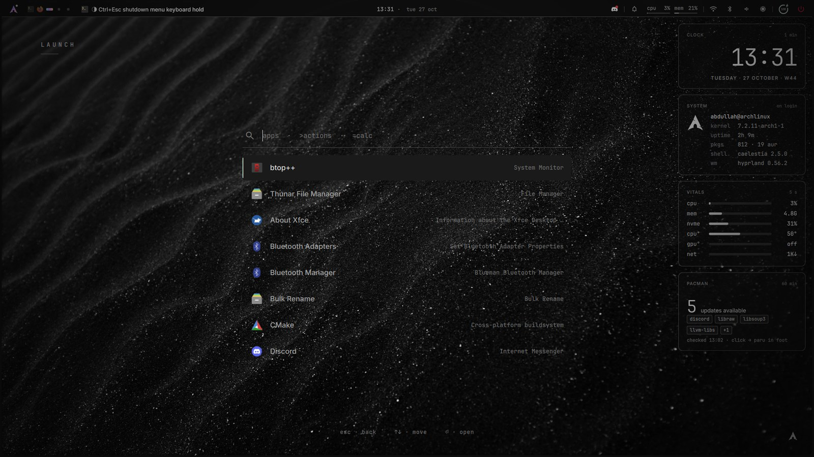
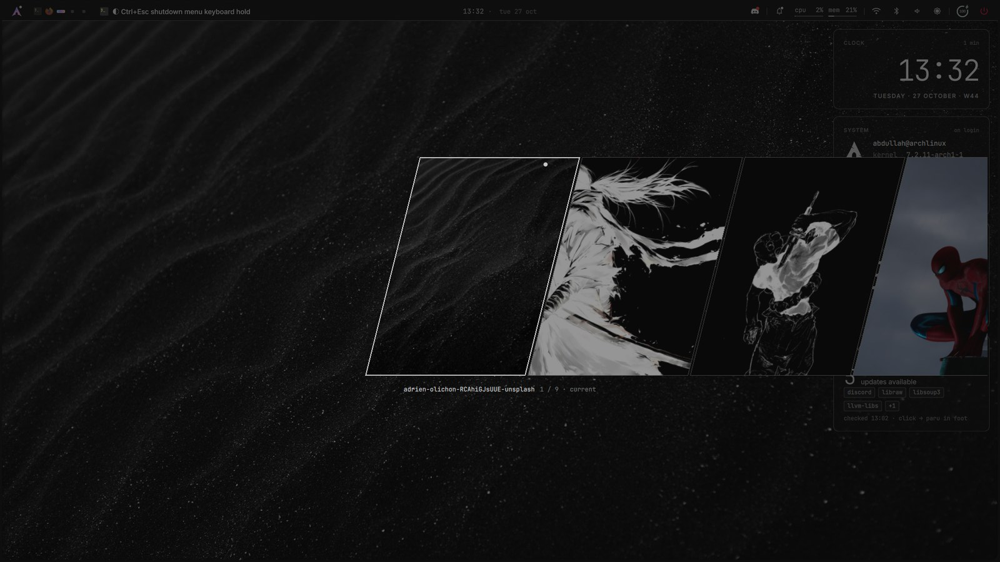
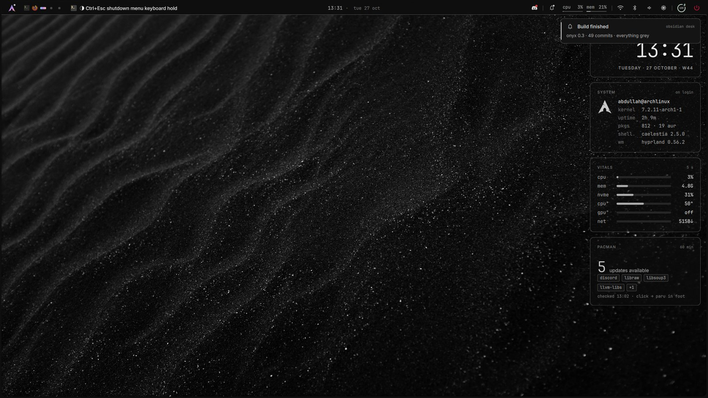
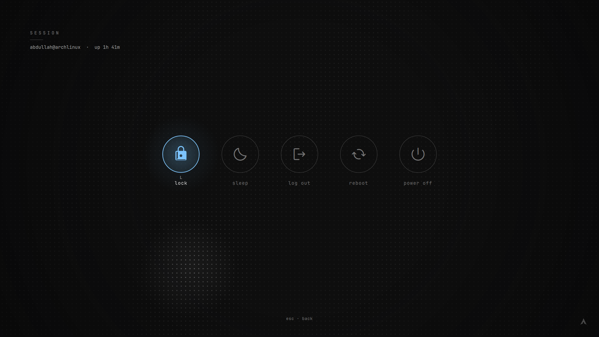
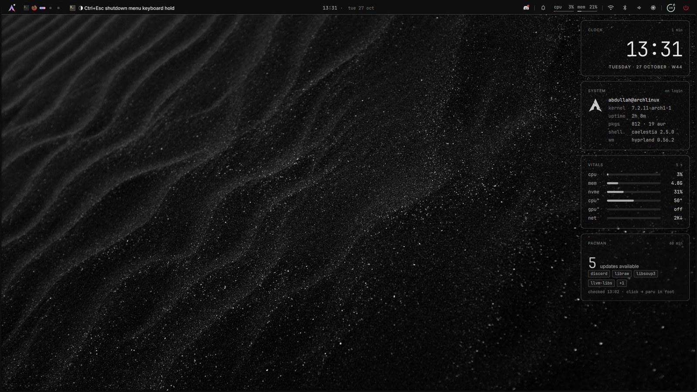
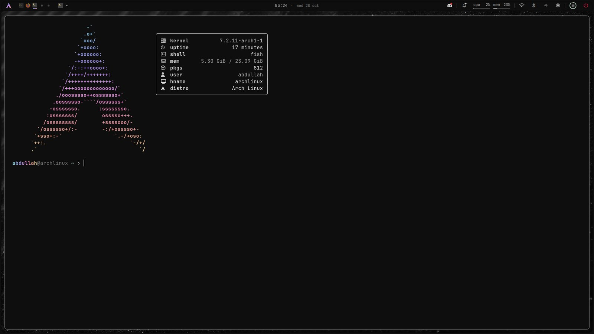
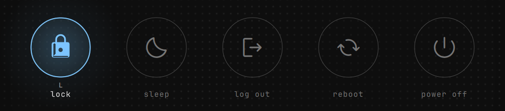
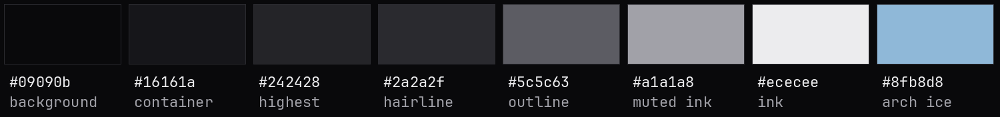

<div align="center">



<br>

**A near-black, zero-chroma desktop for Arch Linux · Hyprland · Caelestia · Quickshell**

<sub>Everything is grey. Colour appears only when something is hot.</sub>

<br><br>



</div>

<br>

Obsidian desk keeps [Caelestia](https://github.com/caelestia-dots/shell) installed and untouched
and configures it through `shell.json` and a custom colour scheme. Alongside it runs **onyx**, a
companion [Quickshell](https://quickshell.org) config (`qs -c onyx`) that owns everything you
look at all day: the hidden top bar with hover popouts, the full-screen lock, the session
screen, the launcher, the wallpaper picker, notifications and the desktop widget column.
Thunar, Firefox, the terminal and the boot splash are themed to match.

<br>

<div align="center">
<table>
<tr>
<td align="center" width="50%">
<br>
<sub><b>Launcher</b> · tap Super · apps, <code>&gt;</code> actions, <code>=</code> calculator</sub>
</td>
<td align="center" width="50%">
<br>
<sub><b>Wallpaper picker</b> · Super+Shift+W · a strip of sheared thumbnails</sub>
</td>
</tr>
<tr>
<td align="center" width="50%">
<br>
<sub><b>Notifications</b> · onyx is the daemon · popups under the bar, history on the lock</sub>
</td>
<td align="center" width="50%">
<br>
<sub><b>Session screen</b> · Super+Esc · lock, sleep, log out, reboot, power off</sub>
</td>
</tr>
<tr>
<td align="center" width="50%">
<br>
<sub><b>Desktop</b> · widget column: clock, system, vitals, pacman updates</sub>
</td>
<td align="center" width="50%">
<br>
<sub><b>Terminal</b> · foot, fish, starship, fastfetch on open</sub>
</td>
</tr>
</table>

<br>



<sub>Ring glyphs. Monochrome at rest; on hover or focus each action lights its own accent, and reboot and power off need a hold.</sub>

<br><br>



</div>

<br>

Colours come from `~/.local/state/caelestia/scheme.json`, so `caelestia scheme set …` recolours
the bar, lock, widgets, GTK, browser, terminal, btop and Hyprland together. Chroma is reserved
for **Arch ice** `#8fb8d8` and the session glyph accents.

---

## What you get

| Surface | |
|---|---|
| **Top bar** | 36 px, hidden above the edge until the top edge is touched (or pinned). Arch mark with an updates badge, workspaces, window title, now-playing, clock, tray, notifications, cpu/mem, wifi · bluetooth · audio, battery, power. Every item has a hover popout. |
| **Lock** | `WlSessionLock` + PAM with fingerprint support. Dot field that reacts to the pointer, clock, weather, media, notification history, and the same ring glyphs as the session screen. |
| **Session screen** | Full-screen lock-style surface: lock · sleep · log out · reboot · power off. Each action has its own accent; reboot and power off need a hold. |
| **Launcher** | Tap Super. Apps, `>` actions, `=` calculator. Most-used apps float to the top. |
| **Wallpaper picker** | A strip of sheared thumbnails driven by `caelestia wallpaper`. |
| **Notifications** | onyx is the notification daemon: popups under the bar, actions as chips, DND, history in the bell popout and on the lock. |
| **Widgets** | Clock, system, vitals and updates cards on the desktop. Click-through except the updates card. |
| **Boot splash** | An Onyx Plymouth theme: near-black, Arch mark, hairline progress. |
| **Apps** | Thunar (details view, hidden menubar, location entry), Firefox chrome, foot, fish, fzf, starship and btop all follow the live scheme. |

## Keys

| | |
|---|---|
| `Super` (tap) | launcher |
| `Super + L` | lock (after `enable-lock.sh`) |
| `Super + Esc` · `Ctrl + Alt + Del` | session screen |
| `Super + Shift + B` | pin / unpin the bar |
| `Super + Shift + W` | wallpaper picker |
| `Super + Ctrl + Space` | Caelestia's own launcher |
| `Super + Ctrl + L` | Caelestia's own lock |

Inside the session screen: `←` `→` or `Tab` move, `Enter` or `Space` activates, `l s o r p` jump
straight to an action, hold for reboot and power off, `Esc` backs out.

Everything is also reachable over IPC:

```sh
qs -c onyx ipc call bar pin|unpin|toggle
qs -c onyx ipc call lock lock
qs -c onyx ipc call session toggle
qs -c onyx ipc call launcher toggle
qs -c onyx ipc call wallpaper toggle
```

## Install

```sh
./install.sh
```

Idempotent, run as your user. Everything it replaces is backed up under
`~/.local/state/caelestia/backups/obsidian-<date>/`. The few root-only steps are printed at
the end (`pacman -S inter-font`, copying the scheme into the CLI's data dir,
`papirus-folders -C grey`). Run them, then run `./install.sh` again to finish with
`caelestia scheme set -n onyx -f obsidian -m dark`.

Run `./install.sh` again after every `caelestia-cli` update: the scheme lives inside the
package's data directory and is lost on upgrade.

Optional, for the boot splash:

```sh
qs -p plymouth/render-logo.qml      # renders the logo (already committed)
sudo bash plymouth/install.sh       # theme, hook, `splash`, initramfs and GRUB
```

## The lock, read before binding it

A session lock that cannot unlock is a hard lockout. `install.sh` therefore leaves Super+L, the
idle timeout and the login lock on Caelestia's lock, and ships the companion lock with a 30 s
debug auto-unlock (`lockDebugAutoUnlockSec` in `~/.config/onyx/config.json`).

1. Open a second TTY (`Ctrl+Alt+F3`) and log in, so a stuck lock can be killed with
   `pkill -f "qs -c onyx"`.
2. `qs -c onyx ipc call lock lock`, type a wrong password (it shakes), then the right one.
   Repeat three times, on every monitor. `qs -p ~/.config/quickshell/onyx/LockHarness.qml`
   shows the same surface in a plain window with real PAM for visual checks.
3. `./enable-lock.sh` turns the auto-unlock off and moves the idle action, Super+L and the
   login lock to the companion lock. Caelestia's lock moves to Super+Ctrl+L and Super+Alt+L
   stays the dots' restore-lock. `./enable-lock.sh --undo` reverts all of it.

Once verified, onyx starts locked, so the lock screen is the first frame of every login.

## Settings

`~/.config/onyx/config.json` is watched and applies live:

| Key | |
|---|---|
| `reducedMotion` | zero-duration animations everywhere |
| `barPinned` | bar always visible and reserving its 36 px (default) or hidden above the edge |
| `updatesIntervalMin` · `updatesOnBattery` | update check cadence |
| `wallpaper.{dir,shown,height,shear,keepOpen}` | picker |
| `widgetsEnabled` · `widgets.{clock,system,vitals,updates}` | desktop cards |
| `perfCommand` · `updatesCommand` · `logoutCommand` | what the cards and the session screen run |
| `notifTimeoutMs` · `notifPopupsMax` · `trayHidden` | notifications and tray |
| `lock.{hideNotifs,use24h,showWeather,showMedia,dotField}` | lock surface |

Caelestia keeps its dashboard, sidebar and launcher on their own keybinds. Its bar
(`bar.excludedScreens`), right-edge OSD (`osd.enabled: false`) and sidebar hover
(`sidebar.showOnHover: false`) are off, and its tray lives in the onyx bar.

## Layout

```
install.sh / uninstall.sh / enable-lock.sh / desk-restart.sh / lib.sh
caelestia/shell.json  caelestia/cli.json          merged into ~/.config/caelestia (your extra keys are kept)
caelestia/templates/gtk.css                        rendered by the CLI into ~/.local/state/caelestia/theme/gtk.css
caelestia/hooks/post-scheme.sh                     cli.json postHook: Graphite icons, Papirus grey folders, dconf gtk/icon theme
caelestia/override/                                disables Caelestia's notification server
icons/graphite-generate.py                         ~/.local/share/icons/Graphite: monochrome line icons from the live scheme
scheme/dark.txt                                    <scheme_data_dir>/onyx/obsidian/dark.txt  (needs sudo)
quickshell/onyx/                                   ~/.config/quickshell/onyx  (bar/ lock/ session/ launcher/ widgets/ services/ …)
onyx/config.json                                   ~/.config/onyx/config.json
hypr/obsidian.lua  hypr/hypr-vars.lua  hypr/hypr-user.lua   ~/.config/caelestia/ (Lua dots); hypr/obsidian.conf for classic configs
thunar/apply.sh                                    xfconf: details view, hidden menubar (Ctrl+M), location entry, thumbnails
firefox/userChrome.css  firefox/apply.sh          scheme-rendered browser chrome, linked into every Firefox profile
terminal/                                          fish user-config (fzf keys, bat, h <cmd>), fzf/starship templates, foot tweaks
plymouth/                                          Onyx boot splash theme and installer
docs/                                              screenshots and the palette used in this README
```

## Revert

```sh
./uninstall.sh            # restores the latest obsidian-* backup
./uninstall.sh <backup>   # or a specific one
```

`desk-restart` reloads Hyprland and restarts both shells. It refuses to run while the
companion lock is engaged. There is no watchdog: if a shell dies, run this.

## Under the hood

- Widgets sit on the `bottom` layer rather than `background`, so Caelestia's wallpaper layer
  cannot cover them when the shell restarts.
- Game mode (Caelestia) hides the bar, hot zone and widgets. The state is read on start, on
  `configreloaded` and on each hot-zone contact. Nothing polls.
- The lock's dot field paints its slow wave once into a canvas one period wider than the
  screen and slides it in whole grid steps. At rest nothing is repainted.
- Colour roles are exposed as `Scheme.fgSurface` instead of `onSurface`: a QML property that
  starts with `on` plus a capital letter is parsed as a signal handler.
- onyx locks on login only on the first load of the process. A hot reload (any file edit under
  the config dir) carries a `PersistentProperties` flag across and leaves the session alone.
- `~/.config/foot/foot.ini` is also set to alpha 1.0 on this machine. It is a dots-owned file,
  so `caelestia update` may reset it.

<br>

<div align="center"><sub>Wallpaper in the screenshots: black sand by Adrien Olichon on Unsplash.</sub></div>
